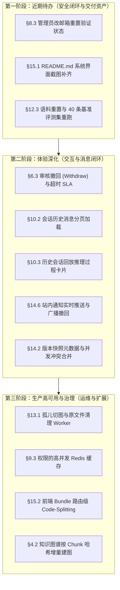

# 待实现项与系统演进规划（Pending Improvements & Roadmap）

> **文档定位**：记录系统在各迭代周期识别出的设计缺口、待办优化及演进任务。每项包含背景、现状、候选方案与触发条件，并在功能闭环后及时标注完成状态与解决方案。
> 
> **最新状态审计时间**：2026-10-30

---

## 目录与状态总览

| 模块 / 领域 | 事项清单 | 当前状态 | 优先级 |
| :--- | :--- | :---: | :---: |
| **文档与存储** | §1 文档与源文件关联 | ✅ 已解决 | - |
| | §2 文件存储访问策略与私有鉴权 | ✅ 已解决 | - |
| | §7 对象存储双模式（OSS / RustFS） | ✅ 已解决 | - |
| | §13.1 导入失败与孤儿切图自动清理 Worker | ⏳ 待实现 | P2 |
| **检索与 RAG** | §3.1 Embedding Key 与基础设施配置 | ⚙️ 环境配置 | - |
| | §3.2 换模型全量重索引入口 | ✅ 已解决 | - |
| | §3.3 异步化批量重建与失败指数退避重试 | ✅ 已解决 | - |
| | §3.4 召回期可见性过滤（RBAC / 团队） | ✅ 已解决 | - |
| | §3.5 向量召回质量（Rerank 精排 + 查询改写） | ✅ 已解决 | - |
| | §3.6 `RAG_MIN_SCORE` 与分块超参数真实语料校准 | ⏳ 待校准 | P2 |
| | §3.7 父子分块（Hierarchical / Parent-Child Chunking） | ⏳ 待评估 | P3 |
| **知识图谱 (KG)** | §4.1 异步任务状态通用查询接口 (`GET /tasks/:taskId`) | ✅ 已解决 | - |
| | §4.2 实体关系抽取增量更新（按 Chunk 哈希重抽） | ⏳ 待实现 | P2 |
| | §4.3 关系边语义细化（属性转原生边类型） | ⏳ 待评估 | P3 |
| **文档审核** | §6.1 审核人身份鉴权与防冒用 | ✅ 已解决 | - |
| | §6.2 索引失败补偿任务表与可见性巡检 | ✅ 已解决 | - |
| | §6.3 审核撤回（Withdraw）与超时 SLA 流转 | ⏳ 待实现 | P1 |
| | §6.4 归档文档重新上架 / 恢复草稿流转 | ⏳ 待决策 | P2 |
| | §6.5 审核历史数据物理归档策略 | ⏳ 待规划 | P3 |
| **用户与鉴权** | §8.1 登录与验证码 Redis 限流与锁定 | ✅ 已解决 | - |
| | §8.2 重发激活邮件与管理员代发入口 | ✅ 已解决 | - |
| | §8.4 过期未激活账号定时/启动惰性清理 | ✅ 已解决 | - |
| | §8.3 管理员改邮箱重置验证状态 | ⏳ 待实现 | P1 |
| | §8.5 高危管理端点敏感操作审计日志 (Audit Log) | ⏳ 待实现 | P2 |
| | §8.6 手机短信（SMS）通道扩展 | ⏳ 待扩展 | P3 |
| **权限体系 (RBAC)** | §9.1 业务接口全量权限码化 | ✅ 已解决 | - |
| | §9.2 树形构建算法优化 ($O(N)$ 桶化) | ✅ 已解决 | - |
| | §9.3 权限的高并发 Redis 缓存与淘汰机制 | ⏳ 待压测引入 | P2 |
| | §9.4 权限树层级继承（授予父即含子） | ⏳ 待评估 | P3 |
| **AI 会话与对话** | §10.1 多轮对话上下文进 Prompt（短期+长期记忆） | ✅ 已解决 | - |
| | §11.1 流式接口 401 令牌刷新重试 | ✅ 已解决 | - |
| | §10.2 会话历史消息分页加载 | ⏳ 待实现 | P1 |
| | §10.3 历史会话回放推理过程卡片（意图/评估/图谱） | ⏳ 待实现 | P1 |
| | §11.2 `web_search` 结构化监控与调用统计 | ⏳ 待实现 | P2 |
| **评测与可观测性** | §12.1 9 条冒烟集金标条款真实校准 | ✅ 已解决 | - |
| | §12.2 PDF 康熙部首与异体字 NFKC 归一化 | ✅ 已解决 | - |
| | §12.3 40 条基准评测集重置重跑（正式基线） | ⏳ 待数据重置 | P1 |
| | §12.4 Langfuse 带字段脱敏的逐 Token 耗时追溯 | ⏳ 待评估 | P2 |
| | §12.5 单题评测独立 Wall-Clock 超时控制 | ⏳ 待实现 | P2 |
| **产品体验 (v21)** | §14.1 文档分类删除时的文档批量迁移能力 | ⏳ 待实现 | P2 |
| | §14.2 文档历史版本元数据快照与并发合并 (Diff/Merge) | ⏳ 待实现 | P1 |
| | §14.3 文档评论区分页加载与评论治理 | ⏳ 待实现 | P2 |
| | §14.4 点赞通知天级时间窗口去重 | ⏳ 待实现 | P2 |
| | §14.5 分享链接访问统计 (PV/UV/最后访问) | ⏳ 待实现 | P2 |
| | §14.6 站内通知 WebSocket / SSE 实时推送与广播撤回 | ⏳ 待实现 | P1 |
| **工程交付** | §15.1 README.md 4 处系统功能截图补全 | ⏳ 待补充 | P1 |
| | §15.2 前端 Bundle 体积优化与路由级 Code-Splitting | ⏳ 待优化 | P2 |

---

## 1. 文档与源文件的关联缺失

> 记录时间：2026-09-17  
> **状态：✅ 已解决（2026-09-19）**

**解决方案**：采用原「方案 A + object_key 兼容」的组合——`kh_document` 新增 5 个可空列 `file_url / object_key / file_name / file_size / file_extension`，上传链路（`DocumentService.uploadAndCreateDocument`）经内部参数 `DocumentFileInfo` 写入。`RustfsService.uploadBytes` 改为返回 `{ url, key }` 以取得 object_key。

---

## 2. fileUrl 的存储形态与私有访问策略

> 记录时间：2026-09-17  
> **状态：✅ 已解决（2026-10-28 在 feat-v20 及 feat-v21 闭环）**

**解决方案**：
- 在存储底层彻底放弃“公开桶直链（Public Bucket URL）”方案，消除匿名访问越权风险；
- 原文件与 MinerU 提取的切图资源存入对象存储时，每资源随机生成 AES-256-GCM 密钥落库 `kh_document_resource`，密文持久化；
- **系统内访问**：通过 `GET /documents/:id/{source,assets/:assetId}` 接口，受统一文档 ACL 与登录态保护，鉴权通过后流式解密输出；
- **外发分享访问**：文档分享页（免登录）通过短期 HMAC 签名 URL (`/shares/:code/assets/:id?exp=...&sig=...`) 换取图片，既保障分享页图片正常渲染，又阻断了直接爬取文档资源路径的漏洞。

---

## 3. RAG 检索管线遗留项

> 记录时间：2026-09-19

| 项 | 说明 | 现状 / 触发条件 | 状态 |
| :--- | :--- | :--- | :---: |
| **Embedding Key 待配置** | `.env` 中 `EMBEDDING_API_KEY` 为空时，向量检索降级返回空 | 配置阿里云百炼 Key 即生效，无需改代码 | ⚙️ 待配置 |
| **换模型后全量重索引** | 切换模型后旧向量与新空间不兼容，需全量重算 | ✅ 已实现：`POST /rag/reindex` 由 BullMQ 异步执行，同时更新 `kh_chunk` 与 `kh_document` | ✅ 已解决 |
| **异步化与指数退避重试** | 批量重建若同步运行易超时崩溃 | ✅ 已实现：BullMQ 接入，配置 3 次重试与指数退避 | ✅ 已解决 |
| **检索可见性过滤** | 检索未结合用户团队与权限，仅看发布态 | ✅ 已实现：feat-v15 打通 PG/ES/Neo4j 三存储同一可见性 SSOT 过滤 | ✅ 已解决 |
| **向量召回质量与精排** | 口语化查询相似度低，BM25 偶然误召回 | ✅ 已实现：feat-v11 引入 Reranker 精排，feat-v16/v17 引入意图路由与改写 | ✅ 已解决 |
| **`RAG_MIN_SCORE` 校准** | 初始阈值 0.72 仅经小样本测定 | 待换真实大规模语料后，重测相关与不相关分数分布 | ⏳ 待校准 |
| **分块效果调优** | 1024 字符分块与 IK 膨胀率为经验值 | 依据真实业务语料召回率与跨块语义完整度调优 | ⏳ 待调优 |
| **父子分块 (Parent-Child)** | 平面滑动窗口可能在命中精准时丢失大上下文 | 待业务出现长篇连续逻辑需大段召回时引入（加 `parent_id`） | ⏳ 待评估 |
| **超长单段切分单测** | 单测覆盖无分隔符的超长段落降级切分 | ✅ 已补充单测覆盖锁死边界 | ✅ 已解决 |

---

## 4. 知识图谱 (KG) 遗留项

> 记录时间：2026-09-20（feat-v5）

| 项 | 说明 | 现状 / 触发条件 | 状态 |
| :--- | :--- | :--- | :---: |
| **任务状态查询接口** | BullMQ 异步建图状态外部不可见 | ✅ 已解决：`GET /tasks/:taskId` 支持全队列统一查任务状态 | ✅ 已解决 |
| **增量更新（只重抽变更块）** | 文档微调小段内容后，发布仍全篇重抽实体关系（耗时长、Token 消耗大） | 出现高频小版本修改场景或 Token 成本成为负担时做：比对 Chunk 内容哈希，仅抽变更块并 MERGE 覆盖 | ⏳ 待实现 (P2) |
| **关系语义属性转原生边** | 实体间边恒为 `RELATED_TO`，具体语义在 `r.relation` 属性，复杂 Cypher 无法走边索引 | 待数据量与多跳查询扩展时评估改造 | ⏳ 待评估 (P3) |

---

## 5. RAG 已识别的环境与技术约束（非缺口，需保持感知）

1. **ES 免费版不支持原生 RRF**：ES 商业特性 `retriever.rrf` 会抛 `security_exception`，已在应用层自研 RRF 双路归一化融合算法。
2. **`dims: 1024` 不可原地修改**：更换 Embedding 维度必须删除 ES 索引并全量重建。
3. **IK 中文分词器与 ES 版本强绑定**：当前统一固化在 8.17.0。
4. **延迟初始化原则**：ES、Redis、Neo4j、Embedding Key 缺失均不阻断应用主进程启动，提供健康检查探测与优雅降级。

---

## 6. 文档审核与流转遗留项

> 记录时间：2026-09-24（feat-v6）

| 项 | 说明 | 现状 / 触发条件 | 状态 |
| :--- | :--- | :--- | :---: |
| **审核人身份鉴权** | 初始由请求体传入，任何人均可审批 | ✅ 已解决：feat-v7 改从 JWT 登录态取，端点挂 `@Roles(REVIEWER, ADMIN)` | ✅ 已解决 |
| **索引写入失败自动补偿** | 审核发布后若 ES / Neo4j 写入失败只记日志 | ✅ 已解决：`kh_index_outbox` 表记录待补偿任务，Worker 退避重试 + 可见性定时巡检 | ✅ 已解决 |
| **审核撤回（Withdraw）** | 作者提交审核后发现写错，无法自行撤回 | 增加作者发起的撤回端点，将待审核转回草稿并作废流水 | ⏳ 待实现 (P1) |
| **审核超时策略 (SLA)** | 待审任务无到期自动提醒、驳回或升级机制 | 针对企业级 SLA，增加超时字段与定时流转任务 | ⏳ 待实现 (P1) |
| **归档文档重新上架** | 归档被定为终态，不可重新上线 | 明确产品定义后，支持由管理员恢复为草稿重新走提审 | ⏳ 待决策 (P2) |
| **审核历史数据清理** | 文档物理删除后审核流水成孤儿数据 | 针对物理销毁场景，增加级联清理或归档策略 | ⏳ 待规划 (P3) |

---

## 7. 对象存储双模式（阿里云 OSS 与本地 RustFS）

> 记录时间：2026-09-24  
> **状态：✅ 已解决（分支 `v2-two-storage-mode`）**

**解决方案**：引入 `StorageDriver` 策略模式，基于现有 S3 SDK 实现 `AliyunOssDriver`（Virtual-Hosted 模式，支持自定义 CDN）与 `RustfsDriver`（Path-Style 模式，自动建桶）；统一由 `StorageService` 门面调度，未显式指定且配置 OSS Key 时自动优选 OSS，向下完全兼容。

---

## 8. 用户与账户治理遗留项

> 记录时间：2026-09-28

### 8.1 登录与验证码限流 ✅ 已实现（2026-10-22）
- 落地 `AuthRateLimitGuard` + Redis Lua 原子限流（IP / 账号多维隔离）；
- 登录 30次/分/IP；发码 5次/10分/IP；验证码连续错 5 次强制销毁并锁定 10 分钟。

### 8.2 重发激活邮件入口 ✅ 已实现（2026-10-05）
- `POST /auth/activation/resend`（公开端点，凭账号+密码证明归属防邮件轰炸，60s 冷却）；
- `POST /auth/activation/resend/:userId`（管理员代发入口）。

### 8.3 管理员改邮箱不重置验证状态 ⏳ 待实现 (P1)
- **现状**：`UserService.updateUser` 允许管理员修改用户 email，但未重置 `email_verified=0`。
- **风险**：改绑为新邮箱后直接视为已验证，跳过了新邮箱真实所有权核验。
- **方案**：改绑邮箱且系统开启邮箱验证时，置 `email_verified=0` 并自动发送新邮箱激活链接。

### 8.4 未激活账号过期清理 ✅ 已实现（2026-10-05）
- `UserService.purgeInactiveAccounts` 软删 7 天未激活账号，自动释放唯一索引；支持系统启动惰性执行与管理员手动端点。

### 8.5 敏感管理操作审计日志 (Audit Log) ⏳ 待实现 (P2)
- 用户角色分配、强制密码重置、敏感权限调整无系统流水日志，缺乏合规审计追踪。

### 8.6 手机短信（SMS）通道扩展 ⏳ 待扩展 (P3)
- 当前验证码与通知仅支持邮件，接口结构需抽象出多通道 NotifyDriver。

---

## 9. RBAC 权限与组织架构遗留项

> 记录时间：2026-09-30（feat-v9）

| 项 | 说明 | 现状 / 触发条件 | 状态 |
| :--- | :--- | :--- | :---: |
| **检索可见性过滤** | 检索召回未考虑文档公开/团队/作者限制 | ✅ 已解决：feat-v15 实现四链路可见性统一约束与存量回填 | ✅ 已解决 |
| **业务接口权限码化** | 文档 12 接口此前用 `@Roles` 鉴权 | ✅ 已解决：feat-v10 全量挂载 `document:*` 权限码，审核保留角色避免误拦 | ✅ 已解决 |
| **树形构建性能优化** | 递归 filter 为 $O(N^2)$ | ✅ 已解决：重构为 `Map<parentId, list>` 分组，复杂度降为 $O(N)$ | ✅ 已解决 |
| **权限计算高并发 Redis 缓存** | 目前每请求 2~3 条 SQL 计算权限，换取即时生效 | 高并发上线前引入 Redis 缓存与淘汰（角色变更/用户禁用主动 DEL） | ⏳ 待实现 (P2) |
| **权限树层级继承** | 授予父节点权限不自动包含子节点 | 依赖模型升级支持「父含子」语义 | ⏳ 待评估 (P3) |

---

## 10. AI 会话与持久化遗留项

> 记录时间：2026-10-07（feat-v13）

| 项 | 说明 | 现状 / 触发条件 | 状态 |
| :--- | :--- | :--- | :---: |
| **多轮上下文进 LLM** | 单轮追问丢失上文历史 | ✅ 已解决：feat-v16/v17 接入 Redis 短期热窗口 (20条) + Mem0 长期记忆 | ✅ 已解决 |
| **会话历史消息分页** | `GET /chat/sessions/:id` 一次性全量返回所有消息 | 会话消息轮次变长时需增加分页加载机制，避免大响应包与前端卡顿 | ⏳ 待实现 (P1) |
| **历史会话推理过程卡片回放** | 意图分类、评估打分、改写词、图谱匹配卡片为运行期 SSE 事件，未落库 | 优化持久化结构，将 Agent 运行轨迹作为消息 metadata 落库，供历史回放 | ⏳ 待实现 (P1) |
| **落库尽力而为保障** | 会话落库失败不影响回答流式交付 | ✅ 已明确：尽力而为，记录错误日志，不向用户抛出 500 丢失答案 | ✅ 已解决 |

---

## 11. AI 流式对话与联网检索遗留项

> 记录时间：2026-10-09（feat-v14）

| 项 | 说明 | 现状 / 触发条件 | 状态 |
| :--- | :--- | :--- | :---: |
| **流式接口 401 令牌刷新** | `DefaultChatTransport` 自管 fetch 绕过拦截器 | ✅ 已解决：`client.ts` 抽象 `retryWithRefresh`，ChatPage 统一复用刷新逻辑 | ✅ 已解决 |
| **联网搜索多提供商降级** | 单一供应商故障导致联网不可用 | ✅ 已解决：Bocha 与 Tavily 顺序链降级，错误切换、空结果不降级 | ✅ 已解决 |
| **web_search 可观测与统计** | 工具调用只有 warn 日志，无结构化报表 | 需统计外部搜索成本与命中成功率时补充 | ⏳ 待实现 (P2) |
| **前端打包单 Chunk 优化** | ECharts 与 AI SDK 全量引入导致打包包体达 2.8MB | 配置 Vite 路由级与图表级 Code-Splitting 分包 | ⏳ 待优化 (P2) |

---

## 12. Langfuse 观测与 Agent 评测遗留项

> 记录时间：2026-10-26（feat-v19）

| 项 | 说明 | 现状 / 触发条件 | 状态 |
| :--- | :--- | :--- | :---: |
| **冒烟评测集金标校准** | 冒烟集针对真实文档条款重写验证 | ✅ 已解决：完成 9 条冒烟集金标校准并跑通评测验证 | ✅ 已解决 |
| **PDF 异体字与康熙部首规范化** | PDF 原文含变体字（如 `⽆`/`无`）影响检索匹配 | ✅ 已解决：解析层引入 NFKC 规范化过滤 | ✅ 已解决 |
| **40 条基准评测集重置重跑** | 40 条基准集依赖的章节尚未全部上传建图 | **既定动作**：待功能就绪后清空文档数据 → 重新批量上传语料 → 全量重建向量与图谱 → 运行正式基线 | ⏳ 待重置 (P1) |
| **默认模式下 Token 细粒度追溯** | 出于数据出境安全考虑，默认关闭正文回调 | 在确认合规或自建脱敏 Handler 后开放采集 | ⏳ 待评估 (P2) |
| **单题评测超时控制** | 单题受调用次数限制但无物理 wall-clock 超时 | 评测批跑或夜间跑时增加单题硬超时控制 | ⏳ 待实现 (P2) |

---

## 13. 文档导入与多模态解析（feat-v20）遗留项

> 记录时间：2026-10-28

### 13.1 失败任务与孤儿资源自动清理 Worker ⏳ 待实现 (P2)
- **现状**：解析失败、被用户点击忽略（Dismissed）或被新任务覆盖的旧导入任务，其在 OSS/RustFS 中已上传的原文件与中间图片资源目前无自动清理定时任务。
- **方案**：增加周期性扫描清理 Worker，按任务状态与无引用时长物理清理对象存储并软删资源表。

---

## 14. 产品体验与交互体系（feat-v21）遗留项

> 记录时间：2026-10-29

### 14.1 分类删除时的文档批量迁移能力 ⏳ 待实现 (P2)
- **现状**：分类下若有关联文档，删除时抛出 400 异常强行拦截，必须手动逐篇修改文档分类后方可删除。
- **方案**：分类删除对话框提供「转移至目标分类」选项，单事务内将受影响文档的 `category_id` 批量转移后安全删除当前分类。

### 14.2 版本快照元数据与并发合并能力 ⏳ 待实现 (P1)
- **现状**：`kh_document_version` 仅快照正文、标题和摘要，未记录分类、标签及可见性；并发编辑为行锁下的「最后提交者覆盖」，无协同冲突提示。
- **方案**：将文档核心元数据纳入快照版本；并发写入时如基于旧版本修改，给出冲突提示并提供在线 Diff / Merge 对比视图。

### 14.3 评论区分页与互动治理 ⏳ 待实现 (P2)
- **现状**：文档详情页评论为全量一次性加载，且仅支持一层回复。
- **方案**：当评论量级增大时，按顶级评论时间倒序分页加载（`pageSize=20`），回复折叠懒加载。

### 14.4 点赞通知天级时间窗口去重 ⏳ 待实现 (P2)
- **现状**：已实现未读点赞通知去重，但若作者读掉通知后，对方再次点赞依然会产生新通知。
- **方案**：针对同一用户对同一文档的点赞通知增加 24 小时频次收敛窗口，避免频繁打扰作者。

### 14.5 分享链接访问统计 ⏳ 待实现 (P2)
- **现状**：分享链接具备密码保护与私有图片解密签名，但无外部访问统计。
- **方案**：分享表增加 `visit_count`、`last_visited_at`，访问验证通过后异步累加访问指标供作者查看。

### 14.6 站内通知 WebSocket / SSE 实时推送与广播撤回 ⏳ 待实现 (P1)
- **现状**：前端铃铛角标采用 30 秒定时轮询；管理员广播无法撤回且缺少已读率统计。
- **方案**：引入 WebSocket 或轻量 SSE 通知通道实现即时触达；广播支持撤回（标记已废止）与已读人数统计。

---

## 15. 工程交付与前端资产待办

### 15.1 README.md 系统功能截图补全 ⏳ 待补充 (P1)
- **现状**：`README.md` 中文档工作台、检索结果、AI 问答、知识图谱 4 处预览图目前为占位状态。
- **方案**：本地联调环境截取高保真工作台界面图，置于 `docs/assets/screenshots/` 并在 `README.md` 中引用展示。

### 15.2 前端 Bundle 体积优化 ⏳ 待优化 (P2)
- **现状**：Vite 生产打包生成单个 2.8MB 大 Chunk（包含 ECharts、AI SDK 全量包）。
- **方案**：配置 `manualChunks` 拆分 vendor：将 ECharts、React/AntD、Markdown 渲染及业务页面按路由懒加载拆分。

---

## 建议后续落地路线图（Roadmap）

